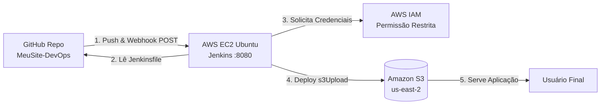
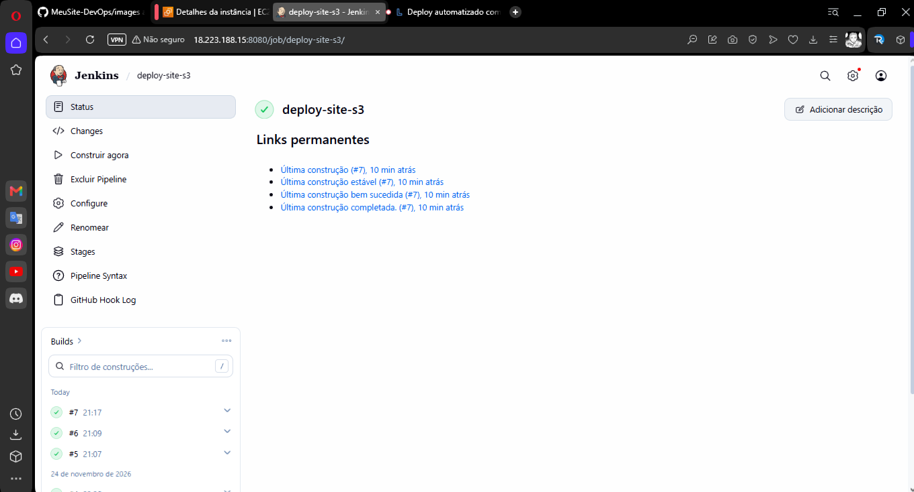
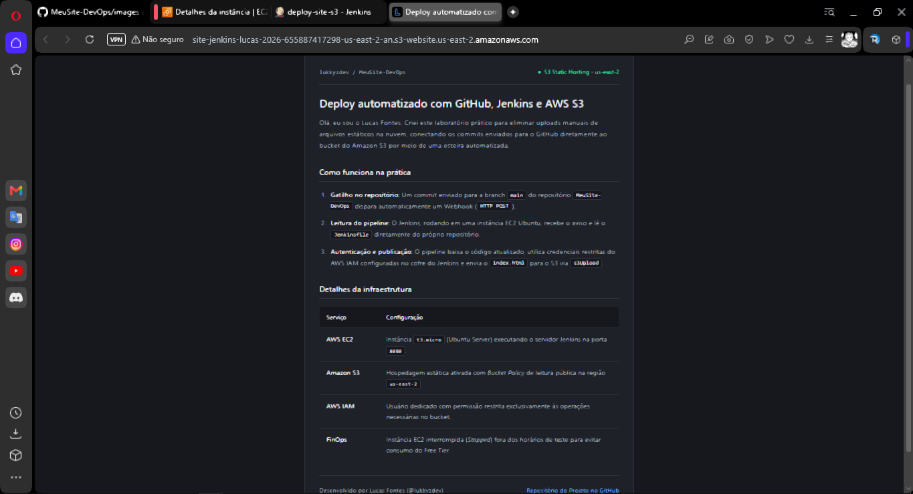

# Pipeline CI/CD Automatizado: GitHub + Jenkins + AWS S3


Este projeto implementa uma esteira completa de **Integração e Entrega Contínua (CI/CD)** na nuvem AWS. O objetivo é eliminar deploys manuais: a cada `push` realizado na branch `main`, o GitHub notifica um servidor **Jenkins** hospedado em uma instância **EC2 (Ubuntu)**, que baixa o código atualizado, autentica via **IAM** e publica a nova versão automaticamente em um bucket **Amazon S3** configurado como servidor web.

🌐 **Endpoint do Site (S3 Static Hosting):** `http://site-jenkins-lucas-2026-655887417298-us-east-2-an.s3-website.us-east-2.amazonaws.com`  

*(Nota: A instância EC2 permanece interrompida fora dos horários de laboratório para otimização de custos na AWS).*

---

## 🏗️ Arquitetura da Solução



---

## 🛠️ Stack Tecnológica e Infraestrutura

| Camada | Serviço / Ferramenta | Função na Arquitetura |
| :--- | :--- | :--- |
| **Computação** | **Amazon EC2 (`t3.micro`)** | Máquina virtual Ubuntu Server configurada via SSH para rodar o motor de automação. |
| **CI/CD** | **Jenkins + AWS Steps** | Orquestrador do pipeline declarativo (`Pipeline script from SCM`) escutando eventos do GitHub. |
| **Hospedagem** | **Amazon S3 (`us-east-2`)** | Bucket configurado com *Static Website Hosting* e *Bucket Policy* de leitura pública. |
| **Segurança** | **AWS IAM & Jenkins Vault** | Usuário programático com acesso restrito ao bucket e injeção segura de chaves em tempo de execução. |
| **Versionamento** | **Git & GitHub Webhooks** | Controle de versão do código HTML e do `Jenkinsfile`, com gatilho HTTP `POST` (`application/json`). |

---

## ⚙️ Como o Pipeline Funciona (`Jenkinsfile`)

Todo o fluxo de entrega está versionado como código (*Pipeline as Code*) no arquivo `Jenkinsfile` na raiz deste repositório:

1- **Gatilho Automático:** O webhook do GitHub dispara uma requisição para `/github-webhook/` assim que um commit entra na branch `main`.

2- **Stage 1 — `Baixar Código do GitHub`:** O agente do Jenkins clona a versão mais recente do repositório.

3- **Stage 2 — `Enviar para o AWS S3`:** O bloco `withAWS(credentials: 'aws-s3-creds', region: 'us-east-2')` injeta as chaves do IAM sem expô-las no código e executa o `s3Upload` atualizando o `index.html` em produção.

---

## 🔒 Práticas de Segurança e FinOps

* **Zero segredos no repositório:** Nenhuma `Access Key` ou `Secret Key` é armazenada no `Jenkinsfile`; as credenciais ficam isoladas no cofre interno do Jenkins.
* **Princípio do Menor Privilégio (IAM):** O usuário `jenkins-deploy` possui permissões limitadas apenas às operações necessárias no bucket do projeto, sem privilégios administrativos na conta.
* **Controle de Custos (FinOps):** A instância EC2 é interrompida (*Stopped*) após os testes de validação para evitar consumo desnecessário do Free Tier, mantendo apenas o armazenamento estático no S3.

---

## 🎯 Desafios Técnicos Resolvidos na Prática

Durante a construção deste ambiente, foram diagnosticados e corrigidos pontos reais de infraestrutura:
* **Liberação de Tráfego (Security Groups):** Configuração de regras de entrada na EC2 liberando a porta `22` (SSH) e a porta `8080` para permitir tanto o acesso ao painel do Jenkins quanto a comunicação externa dos Webhooks do GitHub.
* **Acesso Público Controlado no S3:** Ajuste do *Block Public Access* aliado a uma *Bucket Policy* específica (`s3:GetObject`) para permitir visualização web sem abrir permissões de escrita pública.
* **Recuperação e Sessão no Jenkins:** Tratamento de expiração de token CSRF (`HTTP 403`) durante a configuração de credenciais e configuração de autenticação nativa de usuários.

---

## 📸 Evidências de Execução

### - Builds Jenkins 🏗


### - Site publicado no S3 🟢


---

## 📂 Estrutura do Repositório

```text
MeuSite-DevOps/
├── index.html      # Página web estática publicada automaticamente no S3
├── Jenkinsfile     # Pipeline declarativo em Groovy lido pelo Jenkins
└── README.md       # Documentação técnica da arquitetura
```
